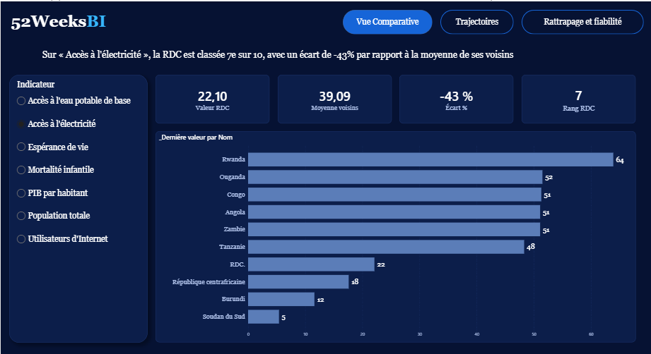
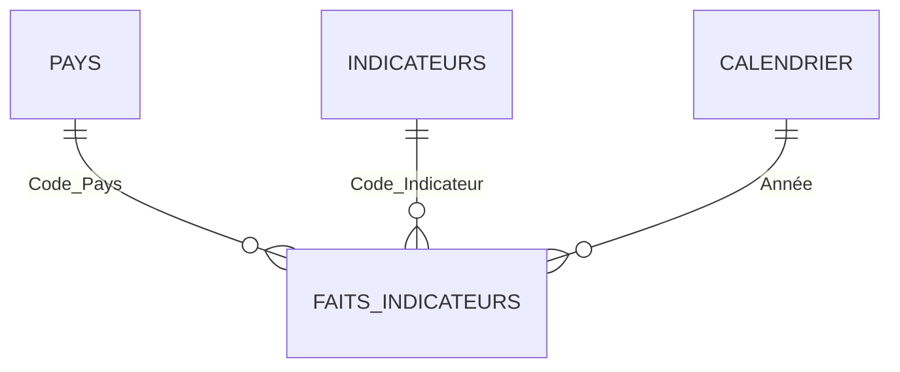

# La RDC rattrape-t-elle ses voisins ? Analyse comparative sur 7 indicateurs (2010-2023)

**Rapport Power BI n°2 · Série 52weeksBI (un rapport par semaine)**

> Rapport interactif de 3 pages qui compare la République démocratique du Congo à ses 9 voisins sur 7 indicateurs de développement, de 2010 à 2023, à partir des données publiques de la Banque mondiale.

**Démonstration vidéo** : [lien vers la vidéo]
**Rapport en ligne** : [lien vers le rapport publié, si disponible]
**Auteur** : Lucien Ramazani Kabobo, Data Analyst et formateur Microsoft Power BI



---

## 1. Contexte et objectif

Une organisation internationale prépare une note d'orientation sur le développement en Afrique centrale. Elle veut savoir où se situe la RDC par rapport aux 9 pays qui l'entourent, et si l'écart se réduit ou se creuse depuis 2010.

**Objectif** : permettre à un décideur non technicien de comprendre la situation de la RDC en moins de deux minutes, et lui indiquer la fiabilité des données utilisées.

## 2. Questions traitées

1. Où se situe la RDC par rapport à ses voisins sur chaque indicateur, à la dernière année disponible ?
2. Entre 2010 et 2023, la RDC progresse-t-elle plus vite ou moins vite que la moyenne de ses voisins ?
3. L'écart avec les voisins se réduit-il, et à quel rythme ?
4. Quelle est la fiabilité des données (années manquantes, estimations) ?

## 3. Principaux résultats

> À compléter avec vos résultats réels avant de publier.

| Indicateur | Valeur RDC | Moyenne des voisins | Écart | Rang (sur 10) |
|---|---|---|---|---|
| [Indicateur 1] | [XX] | [XX] | [± X %] | [N] |
| [Indicateur 2] | [XX] | [XX] | [± X %] | [N] |
| [Indicateur 3] | [XX] | [XX] | [± X %] | [N] |

**Constats clés**

- [Constat 1 : par exemple, sur l'accès à l'électricité, la RDC est classée Ne sur 10, avec X % de la moyenne de ses voisins.]
- [Constat 2 : l'écart avec les voisins se réduit / se creuse sur ... : X % de la moyenne en 2010, Y % en 2023.]
- [Constat 3 : l'indicateur sur lequel la RDC progresse le plus vite, ou le plus lentement.]

Pour les indicateurs où plus bas est mieux (mortalité infantile), le rang est calculé en tenant compte du sens de lecture : 1 = meilleur.

## 4. Pages du rapport

| Page | Contenu |
|---|---|
| 1. Vue comparative | Choix de l'indicateur, valeur de la RDC, moyenne des voisins, écart, rang, classement des 10 pays |
| 2. Trajectoires | Courbes 2010-2023 de la RDC et de la moyenne des voisins, tableau des variations par pays |
| 3. Rattrapage et fiabilité | RDC en % de la moyenne des voisins, matrice de couverture des données, limites |

Chaque titre de page est un constat qui s'adapte à l'indicateur choisi (mesures DAX de texte).

## 5. Données

**Source** : Banque mondiale, World Development Indicators, chargées via l'API publique (voir `docs/requete_API.txt`). Date de chargement : [jj/mm/aaaa]. Licence d'utilisation : à vérifier sur le site de la Banque mondiale (catalogue de données ouvertes).

**Pays (10)** : RDC (COD), Angola (AGO), Burundi (BDI), Congo (COG), Zambie (ZMB), Tanzanie (TZA), Ouganda (UGA), Rwanda (RWA), Soudan du Sud (SSD), République centrafricaine (CAF).

**Période** : 2010 à 2023 (14 années), soit 980 observations.

| Code | Indicateur | Unité | Lecture |
|---|---|---|---|
| NY.GDP.PCAP.CD | PIB par habitant | US$ courants | Plus haut = mieux |
| SP.DYN.LE00.IN | Espérance de vie à la naissance | Années | Plus haut = mieux |
| EG.ELC.ACCS.ZS | Accès à l'électricité | % population | Plus haut = mieux |
| IT.NET.USER.ZS | Utilisateurs d'Internet | % population | Plus haut = mieux |
| SP.POP.TOTL | Population totale | Habitants | Contexte |
| SP.DYN.IMRT.IN | Mortalité infantile | Pour 1 000 naissances | Plus bas = mieux |
| SH.H2O.BASW.ZS | Accès à l'eau potable de base | % population | Plus haut = mieux |

**Remplacement d'un indicateur** : la scolarisation primaire (SE.PRM.NENR) a été écartée après un contrôle de couverture (14 % à 50 % selon les pays, aucune donnée pour la RDC). Elle a été remplacée par l'accès à l'eau potable.

## 6. Modèle de données

Modèle en étoile avec `Faits_Indicateurs` au centre.



| Table | Rôle |
|---|---|
| `Faits_Indicateurs` | Code_Pays, Code_Indicateur, Année, Valeur (980 lignes) |
| `Pays` | Nom en français, Groupe (RDC ou Voisin) |
| `Indicateurs` | Nom, unité, sens de lecture |
| `Calendrier` | Années 2010 à 2023 |

## 7. Méthodologie

1. **Chargement** : requête Power Query sur l'API de la Banque mondiale, format JSON, une fonction appelée pour chaque indicateur.
2. **Contrôle de couverture** : matrice pays par indicateur, colorée selon la part des années disponibles (80 % ou plus : conserver ; 50 à 79 % : conserver avec mention ; moins de 50 % : remplacer).
3. **Modélisation** : relations en étoile, table de dates.
4. **Mesures DAX** : dernière valeur disponible, moyenne des voisins, écart, rang, variation, rattrapage.
5. **Visualisation** : thème personnalisé 52weeksBI, titres sous forme de constats.

**Exemples de mesures**

```dax
_Dernière valeur =
VAR derniere =
    CALCULATE(
        MAX(Faits_Indicateurs[Année]),
        FILTER(Faits_Indicateurs, NOT ISBLANK(Faits_Indicateurs[Valeur])))
RETURN
    CALCULATE(SUM(Faits_Indicateurs[Valeur]), Faits_Indicateurs[Année] = derniere)

_Moyenne voisins =
CALCULATE(
    AVERAGEX(VALUES(Pays[Code_Pays]), [_Dernière valeur]),
    REMOVEFILTERS(Pays),
    Pays[Groupe] = "Voisin")

_Écart % = DIVIDE([_Valeur RDC] - [_Moyenne voisins], [_Moyenne voisins])

_RDC en % des voisins = DIVIDE([_RDC annuel], [_Voisins annuel])
```

## 8. Limites de l'analyse

- Les séries sont **complètes mais en partie estimées par modélisation** : une couverture de 100 % ne garantit pas que chaque valeur annuelle ait été mesurée. Les écarts se lisent avec prudence.
- [Pays ou indicateur lacunaire à signaler, par exemple le PIB du Soudan du Sud.]
- Les valeurs sont révisées de temps en temps par la Banque mondiale : les chiffres peuvent différer selon la date de chargement.
- La comparaison avec la moyenne des voisins est un repère, pas une explication : le rapport ne démontre aucune cause.
- La variation de chaque pays est calculée entre sa première et sa dernière année disponible.

## 9. Structure du dépôt

```
├── README.md
├── rapport/
│   ├── Rapport_RDC_Voisins_52weeksBI.pbix
│   └── 52weeksBI_theme_v2.json
└── docs/
    ├── requete_API.txt
    ├── page1.png · page2.png · page3.png
    └── Rapport_RDC_Voisins.pdf
```

## 10. Reproduire le rapport

1. Ouvrir `rapport/Rapport_RDC_Voisins_52weeksBI.pbix` dans Power BI Desktop.
2. Importer le thème : *Affichage*, *Thèmes*, *Parcourir les thèmes*, puis `52weeksBI_theme_v2.json`.
3. Actualiser le modèle : les données sont rechargées depuis l'API (connexion Internet nécessaire, identifiants : Anonyme).
4. Pour reconstruire le modèle à partir de zéro, suivre les requêtes de `docs/requete_API.txt`.

## 11. Compétences démontrées

Chargement de données via une API JSON (Power Query) · Fonction M et requête paramétrée · Contrôle de qualité et de couverture des données · Modélisation en étoile · DAX (CALCULATE, AVERAGEX, REMOVEFILTERS, VAR, mesures de texte dynamiques) · Analyse comparative · Storytelling avec les données · Thème Power BI personnalisé.

## 12. À propos

**52weeksBI** : un rapport Power BI publié chaque semaine, pour transformer des données en décisions.

Lucien Ramazani Kabobo · [LinkedIn] · [Contact]

*Projet réalisé à des fins de démonstration et de formation. Les données proviennent de la Banque mondiale ; l'interprétation reste celle de l'auteur.*
